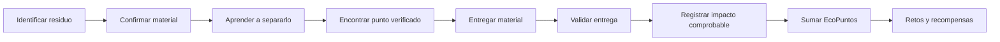
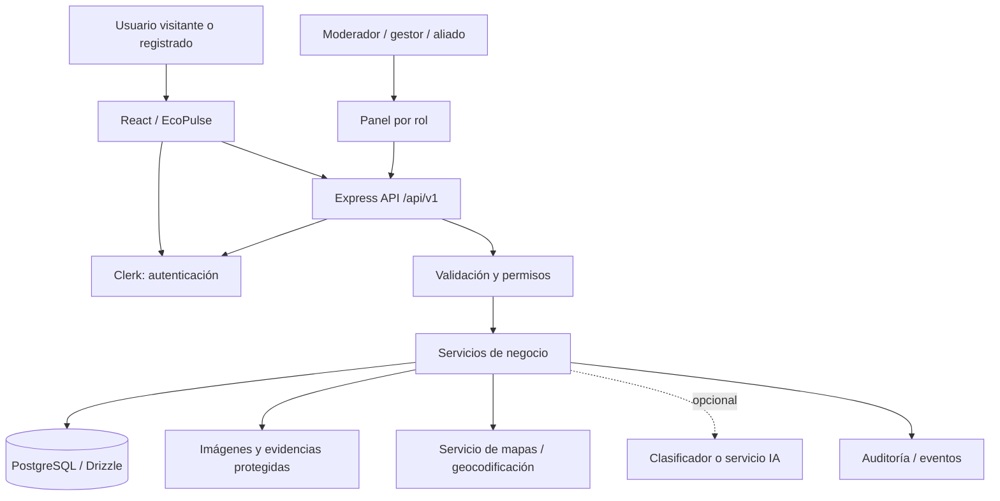
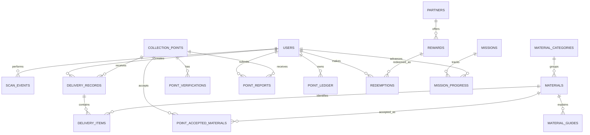
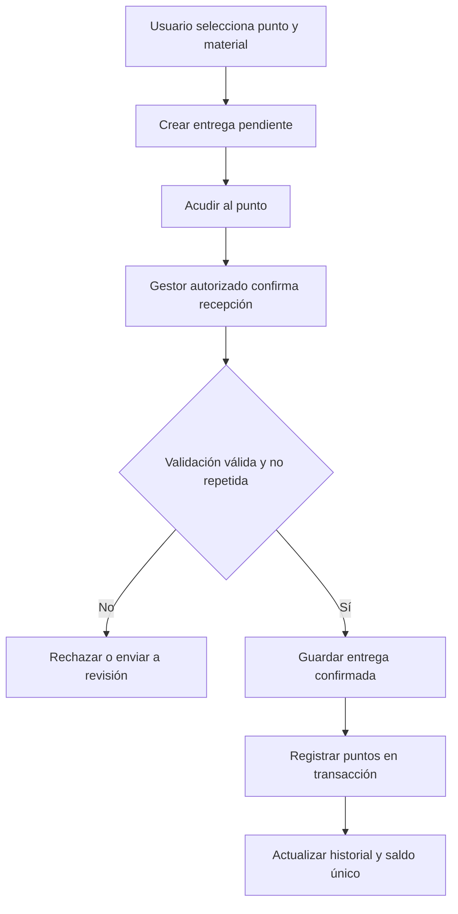
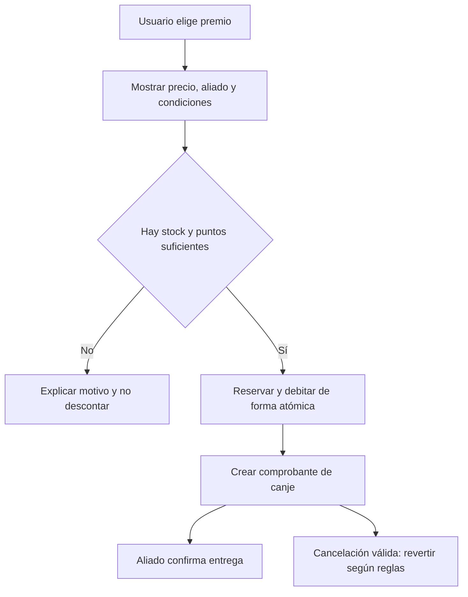

# EcoPulse — Ideas completas de diseño, estructura y mejoras

**Documento de trabajo para evolucionar la aplicación existente**  
**Base principal:** proyecto `Eco-Smart-Hub.zip` (interfaz y estructura de EcoPulse).  
**Referencia complementaria:** `EcoRuta-Colombia.md` (directorio verificable, calidad de datos, IA responsable y gamificación).  
**Fecha de revisión:** octubre de 2026.

> **Objetivo:** saber qué conservar, qué mejorar y qué falta agregar a EcoPulse. Este archivo presenta ideas de producto, pantallas, flujos, funcionalidades y estructura técnica. **No es una afirmación de que todo esté programado**, ni una orden para modificar la aplicación. El estado indicado se refiere al **ZIP aportado**, que puede no coincidir con los avances posteriores de tu copia local.

## Cómo leer este documento

- **[VISTO EN EL ZIP]**: aparece en el código o en la estructura entregada. No significa que se haya probado funcionando en producción.
- **[MEJORAR]**: existe una base visual o funcional, pero requiere integración, precisión o seguridad.
- **[AGREGAR]**: idea nueva o parte no identificada como implementada en el ZIP.
- **[TOMADO DE ECORUTA]**: inspiración respaldada por el documento complementario, no funcionalidad confirmada de EcoPulse.
- **P0**: imprescindible antes de abrir el producto al público. **P1**: mejora principal de producto. **P2**: evolución posterior.

---

# 0. La idea central: cómo debería funcionar EcoPulse

**Propuesta de EcoPulse:** una plataforma ambiental sencilla, atractiva y confiable que ayude a las personas a saber **qué residuo tienen, cómo prepararlo, dónde entregarlo y cómo comprobar su participación**, con educación y recompensas responsables.

### El recorrido ideal, de principio a fin



**Regla principal:** *escanear* no equivale a *reciclar*. El escaneo puede sumar progreso educativo, pero los puntos canjeables por acciones ambientales deben responder a eventos validados. Si no hay centros, aliados ni validación real, se muestra una experiencia **DEMOSTRACIÓN** sin atribuirle impacto real.

## 0.1 Lo que ya tiene la experiencia del ZIP

| Módulo | Qué se observa | Oportunidad |
|---|---|---|
| Landing pública | Marca EcoPulse, mensaje atractivo, CTA de registro, chat flotante | Ajustar afirmaciones, explicar funcionamiento y permitir explorar guías/puntos públicos |
| Inicio de sesión y registro | Interfaz con Clerk, verificación de correo y flujo de sesión | Completar flujos de cuenta y prevenir accesos de demostración en entornos públicos |
| Dashboard / **Tu pulso** | Saldo, progreso, racha, categorías, actividad | Reemplazar cifras fijas por estados reales o marcados como demo |
| Escanear | Subida de imagen, vista previa, identificación de ejemplo y confirmación | Clasificación real o guía manual; impedir que una imagen genere recompensas reales |
| Puntos cercanos | Lista precargada, filtros y mapa incrustado de OpenStreetMap | Directorio real verificado, mapa interactivo vinculado y geolocalización correcta |
| Recompensas | Catálogo de ejemplo, saldo local y modal de canje | Catálogo de aliados reales, inventario, saldo único y transacciones de servidor |
| EcoGuía | Chat con respuestas por palabras clave | Guía basada en materiales, fuentes revisadas, contexto local y límites claros |
| Seguridad | Pantalla Clerk, configuración TOTP y códigos de respaldo | Añadir privacidad, dispositivos/sesiones si el proveedor lo permite y controles de datos |
| Backend | Express y endpoint de salud `/api/healthz` | Construir API de materiales, puntos, entregas, perfil, verificación y recompensas |
| Datos | Carpeta Drizzle preparada, sin tablas de dominio declaradas en el ZIP | Modelo persistente completo con permisos y auditoría |

### Alertas puntuales detectadas en este ZIP

1. La landing presenta cifras como **4,8 mil personas activas** y **28 toneladas** sin evidencia en el código: sustituir por métricas comprobables o etiquetar **dato ilustrativo**.
2. El dashboard muestra valores de ejemplo (kilogramos, racha, nivel y comparaciones) que aún no provienen de mediciones verificadas.
3. El escáner deja **subir una foto**, pero la foto solamente se previsualiza; el ejemplo de clasificación se genera desde un botón separado, sin análisis real de la imagen.
4. El mapa de OpenStreetMap es una vista incrustada de Montería. Las tarjetas de puntos son un arreglo local y **no aparecen como marcadores vinculados** en el mapa; no hay verificación documentada de esos establecimientos.
5. La acción **“Usar mi ubicación”** puede mostrar “Zona detectada” incluso si el permiso falló, y no utiliza coordenadas para recalcular las distancias del listado.
6. El dashboard y Recompensas **no comparten un libro contable de puntos**; manejan cálculos/valores locales distintos, susceptibles de desincronización.
7. Los canjes del ZIP se registran en el navegador, no demuestran una entrega de premio, existencia de un aliado ni reserva de inventario.
8. EcoGuía responde mediante reglas por palabras clave; no se identifica un modelo generativo conectado ni una base documental consultable.
9. El código incluye una ruta de desarrollo cuando falta una clave Clerk que muestra pantallas privadas con identidad ficticia: **no debe convertirse en mecanismo de acceso público**.
10. El archivo `lib/db/src/schema/index.ts` del ZIP no define aún tablas de dominio; su OpenAPI describe únicamente salud. **No concluir por esto que una versión local más reciente carezca de base de datos.**
11. Los datos `ep-scans`, `ep-balance`, `ep-redeemed` y `ep-chat` se guardan en `localStorage` sin separación por identidad. En un navegador compartido, **una cuenta podría ver restos de la demo de otra**. No usar ese almacenamiento como fuente de datos personales o saldos reales.
12. La búsqueda del mapa filtra por **nombre**, aunque promete “nombre o zona”; revisar el comportamiento antes de publicar esa promesa. Las instrucciones por color de contenedor deben verificarse para **Colombia y el gestor local**, en vez de trasladar reglas de otros lugares.

---

# 1. Requisitos funcionales, historias de usuario y criterios de aceptación

> Aquí los requisitos se usan como **ideas concretas de funcionalidades** para decidir qué desarrollar y cómo saber que quedaron bien.

## 1.1 Personas y permisos

| Rol | Lo que puede hacer | Qué no debería hacer |
|---|---|---|
| Visitante | Ver landing, guías, materiales y puntos públicos | Ganar puntos canjeables, editar registros, acceder a datos privados |
| Ciudadano | Mantener perfil, consultar puntos, guardar favoritos, aprender y registrar entregas | Aprobar sus propias entregas, inventar saldo, modificar premios |
| Reciclador / gestor | Consultar entregas asignadas y validar recepción con permisos limitados | Cambiar la verificación de otros puntos o generar premios arbitrarios |
| Responsable de punto | Administrar datos de su punto bajo aprobación y aportar evidencia | Autoverificarse sin revisión inicial o modificar puntos ajenos |
| Moderador | Revisar reportes, centros y entregas sospechosas | Cambiar roles administrativos o alterar libros contables sin autorización |
| Administrador | Gestionar catálogos, roles, validaciones, campañas y auditoría | Saltarse la trazabilidad, operar sin controles ni divulgar datos personales |
| Aliado de recompensas | Publicar oferta validada, confirmar inventario/canjes | Acceder a los datos de usuarios ajenos o a las cuentas internas |
| Institución (opcional) | Ver campañas y estadísticas agregadas autorizadas | Identificar usuarios a partir de métricas individuales |

**Idea de diseño:** una sola aplicación pública y un **panel administrativo independiente por rutas y permisos**, no simplemente pestañas ocultas.

## 1.2 Requisitos priorizados por área

### A. Acceso, identidad y privacidad

- **RF-01 · P0 [VISTO EN EL ZIP / MEJORAR]** Registro con nombre, apellido, correo, contraseña y validación de email; errores comprensibles.
- **RF-02 · P0 [VISTO EN EL ZIP / MEJORAR]** Inicio/cierre de sesión y recuperación segura mediante Clerk.
- **RF-03 · P0 [AGREGAR]** Acceso de invitado a guías y directorio público, sin exigir cuenta para aprender o localizar información.
- **RF-04 · P0 [MEJORAR]** Perfil básico con nombre, municipio opcional, preferencias, privacidad y eliminación/rectificación de datos.
- **RF-05 · P0 [VISTO EN EL ZIP / MEJORAR]** MFA/TOTP, códigos de respaldo y manejo cuidadoso de las sesiones.
- **RF-06 · P0 [AGREGAR]** Autorización por rol **verificada en el servidor**; no confiar en rutas, botones o roles recibidos del cliente.

### B. Identificación de residuos y educación

- **RF-07 · P0 [MEJORAR]** Identificación manual por texto y categorías como alternativa al escáner.
- **RF-08 · P1 [VISTO EN EL ZIP / MEJORAR]** Captura/subida de imágenes con vista previa, validación de tamaño, tipo, errores y privacidad.
- **RF-09 · P1 [AGREGAR]** Clasificación real por imagen, con probabilidad evaluada, varias opciones cuando exista duda y confirmación manual.
- **RF-10 · P0 [TOMADO DE ECORUTA]** Ficha educativa por material: qué es, qué sí/qué no, preparación, excepciones y precauciones.
- **RF-11 · P0 [AGREGAR]** Tratamiento especial para pilas, medicamentos, electrónicos, químicos, cortopunzantes y residuos sanitarios; nunca sugerir contenedores comunes de manera automática.
- **RF-12 · P1 [MEJORAR]** Historial de consultas y aprendizajes, distinguido claramente del historial de entregas verificadas.

### C. Puntos ecológicos y mapa

- **RF-13 · P0 [MEJORAR]** Directorio real consultable en lista y mapa con material, zona, nombre, accesibilidad y estado de verificación.
- **RF-14 · P0 [TOMADO DE ECORUTA]** Ficha de punto: dirección, coordenadas, materiales aceptados, preparación, horarios, contacto, restricciones, fuente y fecha de revisión.
- **RF-15 · P0 [MEJORAR]** Ubicación opcional con permiso explícito; si se deniega, usar búsqueda manual y **no afirmar que fue detectada**.
- **RF-16 · P0 [MEJORAR]** Distancia calculada desde coordenadas reales cuando haya permiso, con método coherente y aviso si es aproximada.
- **RF-17 · P0 [TOMADO DE ECORUTA]** Estados del punto: pendiente, verificado, requiere revisión, inactivo, rechazado.
- **RF-18 · P1 [AGREGAR]** Reportar horario erróneo, punto cerrado, material que ya no acepta y ubicación incorrecta.
- **RF-19 · P1 [AGREGAR]** Favoritos, última consulta y ruta externa para llegar a un punto seleccionado.
- **RF-20 · P1 [AGREGAR]** Solicitud de alta/reclamación de ficha por un gestor; aprobación humana antes de publicar como verificado.

### D. Entregas, confirmación e impacto

- **RF-21 · P0 [AGREGAR]** Crear un registro de entrega con usuario, material, punto, fecha e identificador.
- **RF-22 · P0 [AGREGAR]** Validar la recepción mediante responsable autorizado, código QR de un solo uso u otro mecanismo apropiado.
- **RF-23 · P0 [AGREGAR]** Estados de entrega: iniciada → presentada → pendiente de validación → confirmada o rechazada/cancelada.
- **RF-24 · P0 [AGREGAR]** Impedir duplicaciones de validación; mantener evidencias mínimas y eventos de auditoría.
- **RF-25 · P0 [MEJORAR]** Separar **objetos identificados**, **entregas confirmadas** y **peso medido**. No inferir toneladas o CO₂ desde una fotografía.
- **RF-26 · P1 [AGREGAR]** Mostrar un historial con estado, fecha, material, punto, eventual peso **medido o declarado** y puntos obtenidos, indicando la calidad del dato.

### E. Puntos, retos y premios

- **RF-27 · P0 [MEJORAR]** Un solo saldo autoritativo en el backend, con movimientos de crédito, débito, reversión y ajuste auditado.
- **RF-28 · P0 [AGREGAR]** Diferenciar **XP educativos** (aprendizaje y rachas) de **EcoPuntos canjeables** (acciones elegibles validadas).
- **RF-29 · P1 [AGREGAR]** Misiones personales, retos de barrio/escuela opcionales, insignias y niveles claros.
- **RF-30 · P1 [MEJORAR]** Catálogo de premios con precio en puntos, aliado, disponibilidad, condiciones, caducidad y cobertura.
- **RF-31 · P1 [AGREGAR]** Canje seguro con doble confirmación, reserva de cupo, comprobante, estado de entrega y devolución de puntos si corresponde.
- **RF-32 · P1 [AGREGAR]** Reglas antifraude: límites, detección de repetidos, moderación y bloqueo de acumulación artificial.

### F. EcoGuía y acompañamiento

- **RF-33 · P0 [MEJORAR]** Respuestas básicas exactas basadas en guías revisadas, con enlace directo a cada guía.
- **RF-34 · P1 [AGREGAR]** Búsqueda semántica/asistente con fuentes, municipio, advertencias, dudas y opción “No lo sé con seguridad”.
- **RF-35 · P1 [AGREGAR]** Acciones dentro del chat: “Ver guía”, “Buscar puntos que reciben esto”, “Abrir mi historial”.
- **RF-36 · P1 [AGREGAR]** Escalamiento a un reporte, soporte o contacto oficial ante contenido delicado, sin inventar instrucciones peligrosas.

### G. Comunidad, campañas y operación

- **RF-37 · P1 [TOMADO DE ECORUTA]** Campañas ambientales con fecha, zona, organizador verificado, capacidad y forma de participar.
- **RF-38 · P1 [AGREGAR]** Reportes ciudadanos moderados, con número de caso y seguimiento.
- **RF-39 · P1 [AGREGAR]** Panel administrativo para centros, guías, materiales, reportes, campañas, validaciones y aliados.
- **RF-40 · P1 [AGREGAR]** Tablero de métricas **agregadas** y exportaciones autorizadas, con definición de cada indicador.
- **RF-41 · P0 [AGREGAR]** Estado de sistema, gestión de errores, auditoría, alertas, backups y política de privacidad.
- **RF-42 · P2 [AGREGAR]** Notificaciones configurables: estado de entrega, revisión de reporte, campañas en zona y canjes.

## 1.3 Historias de usuario y aceptación: cómo se debe sentir cada función

| Historia | Quiero… | Criterios de aceptación visibles |
|---|---|---|
| **HU-01 Visitante** | Aprender sin cuenta | Accedo a materiales/guías/puntos públicos sin registrarme; se solicita cuenta solo para funciones personales |
| **HU-02 Registro** | Crear mi cuenta sin problemas | El formulario valida, el correo se verifica, muestra errores útiles y evita cuentas duplicadas según el proveedor |
| **HU-03 Perfil** | Ver y controlar mis datos | Puedo consultar mi perfil, preferencias y opciones de privacidad; las modificaciones persisten realmente |
| **HU-04 Buscar material** | Saber qué hacer con una botella o empaque | Búsqueda tolera términos comunes; ofrece material o categoría; muestra instrucciones y excepciones |
| **HU-05 Escanear** | Identificar una foto | Si hay modelo real, analiza la foto; si solo hay demo, se anuncia; nunca finge certeza ni da puntos canjeables automáticamente |
| **HU-06 Incertidumbre** | Corregir una clasificación | Cuando no hay suficiente confianza puedo elegir manualmente; la corrección no se presenta como verificación automática |
| **HU-07 Residuos especiales** | Evitar errores peligrosos | La ficha advierte riesgos y orienta a canales especializados; no invita a manipular químicos o baterías dañadas |
| **HU-08 Buscar punto** | Encontrar dónde llevar un material | Los resultados aceptan realmente ese material según la ficha; se ve verificación, fecha y ubicación |
| **HU-09 Ubicación** | Buscar cerca de mí | Se pide permiso solo al tocar la opción; si lo niego, no muestra ubicación detectada y puedo buscar por barrio |
| **HU-10 Ficha confiable** | Revisar un centro antes de ir | Veo horario, condiciones, contacto, verificación y aviso cuando un dato no está confirmado |
| **HU-11 Reportar error** | Avisar que un punto cerró | Envío formulario, obtengo ID de seguimiento y mi sugerencia no cambia la ficha sin revisión |
| **HU-12 Gestionar punto** | Mantener mi ficha actualizada | Acredito relación con el punto, solicito cambios, y un autorizado revisa y registra la decisión |
| **HU-13 Registrar entrega** | Dejar constancia de lo que llevé | La entrega queda pendiente hasta confirmación; veo número, fecha y su estado |
| **HU-14 Validar entrega** | Confirmar recepción sin fraude | El actor autorizado confirma o rechaza una sola vez; se registra quién y cuándo |
| **HU-15 Consultar impacto** | Saber qué logré | Distingo búsquedas, escaneos, entregas verificadas y peso medido; no hay cifras ambientales inventadas |
| **HU-16 Ganar puntos** | Entender por qué recibí puntos | Cada movimiento indica acción, fecha y regla aplicada; saldo y movimientos coinciden |
| **HU-17 Canjear** | Cambiar puntos por algo real | Veo inventario, aliado, condiciones, confirmación, comprobante y estado; error/cancelación no consume puntos indebidamente |
| **HU-18 Retos** | Motivarme a continuar | Retos de duración y reglas conocidas, progreso verificable, accesibles sin obligar a publicar datos |
| **HU-19 EcoGuía** | Resolver dudas rápidas | Responde con guías pertinentes, reconoce incertidumbre y enlaza a material/punto, sin inventar convenios |
| **HU-20 Administrador** | Mantener datos confiables | Solo autorizados pueden publicar, verificar, otorgar puntos o editar recompensas; queda auditoría |
| **HU-21 Notificaciones** | No recibir mensajes molestos | Puedo consentir, activar/desactivar y ver avisos sin exponer información sensible |
| **HU-22 Cuenta segura** | Proteger mi acceso | Puedo usar mecanismos del proveedor (MFA/recuperación); no se muestran claves/tokens en errores |

## 1.4 Reglas de aceptación transversales

Una funcionalidad no está terminada solo porque “se vea bonita”. Para darla por lista debe cumplir:

1. **Estado real:** conecta con datos persistentes o está claramente etiquetada como demo.
2. **Acción correcta:** botones ejecutan lo que dicen y explican éxito, fallo o pendiente.
3. **Sin invenciones:** centros, horarios, métricas, canjes, aliados y confianza de IA se sustentan en datos.
4. **Permisos:** el servidor bloquea operaciones de usuarios sin autorización.
5. **Errores claros:** hay estados de carga, vacío, error, reintento y conexión perdida.
6. **Accesibilidad:** funciona con teclado, lector de pantalla, foco visible, contraste y tamaños móviles.
7. **Persistencia:** la información esperada permanece al refrescar y al abrir sesión en otro dispositivo cuando corresponda.
8. **Seguridad:** se validan archivos/entradas; se limitan peticiones abusivas; secretos no salen al navegador.
9. **Trazabilidad:** cambios y acciones sensibles registran responsable, fecha y motivo.
10. **Pruebas:** se validan rutas felices, negativas y casos extremos antes de declararla lista.

---

# 2. Arquitectura del software, modelo de datos y API

> La idea es **aprovechar el stack que ya trae el ZIP** y completar los módulos faltantes, no reescribir EcoPulse con una tecnología diferente.

## 2.1 Arquitectura propuesta, basada en el ZIP

### Tecnologías observadas en el proyecto

- **Frontend:** React + TypeScript + Vite, componentes Tailwind y UI tipo shadcn, íconos Lucide, navegación Wouter.
- **Identidad:** Clerk, usado en el frontend y contemplado en el servidor mediante middleware/proxy.
- **Backend:** Node.js + Express.
- **Base técnica de datos:** PostgreSQL y Drizzle ORM preparados como paquetes; esquema de dominio aún no definido en el ZIP.
- **Contrato de API:** OpenAPI, Zod y generación de cliente mediante Orval, preparados en el monorepo.
- **Datos de demostración:** arreglos embebidos, estado React y `localStorage`.
- **Mapa visible:** iframe de OpenStreetMap como fondo cartográfico; no directorio geoespacial real.

### Estructura objetivo



**Separar responsabilidades:** React presenta; la API valida y decide; PostgreSQL conserva la verdad; el sistema de puntos se gestiona solo en servidor; Clerk autentica, pero no reemplaza los permisos propios del negocio.

### Estructura de carpetas recomendada, respetando el monorepo

```text
Eco-Smart-Hub/
├── artifacts/
│   ├── eco-pulse/
│   │   └── src/
│   │       ├── app/                 # Router, proveedores, navegación
│   │       ├── components/
│   │       │   ├── ui/              # Componentes visuales reutilizables
│   │       │   ├── layout/          # Sidebar, topbar, navegación móvil
│   │       │   └── feedback/        # Vacíos, loaders, errores, badges
│   │       ├── features/
│   │       │   ├── auth/
│   │       │   ├── dashboard/
│   │       │   ├── materials/
│   │       │   ├── scanner/
│   │       │   ├── eco-points/
│   │       │   ├── deliveries/
│   │       │   ├── rewards/
│   │       │   ├── eco-guide/
│   │       │   ├── missions/
│   │       │   ├── reports/
│   │       │   ├── profile/
│   │       │   └── admin/
│   │       ├── services/            # Cliente API e integraciones
│   │       ├── hooks/
│   │       ├── styles/
│   │       └── lib/
│   ├── api-server/
│   │   └── src/
│   │       ├── middlewares/         # Clerk, authZ, errores, rate limit
│   │       ├── routes/              # Entradas HTTP
│   │       ├── modules/
│   │       │   ├── materials/
│   │       │   ├── points/
│   │       │   ├── reports/
│   │       │   ├── scans/
│   │       │   ├── deliveries/
│   │       │   ├── gamification/
│   │       │   ├── rewards/
│   │       │   ├── campaigns/
│   │       │   └── admin/
│   │       ├── services/            # Reglas de negocio
│   │       └── jobs/                # Revisión de fichas y expiraciones
│   └── mockup-sandbox/              # Solo prototipos, no lógica real
├── lib/
│   ├── db/src/schema/              # Tablas y relaciones
│   ├── api-spec/openapi.yaml       # Contrato de endpoints
│   ├── api-zod/                    # Esquemas de validación
│   └── api-client-react/           # Cliente tipado de API
└── tests/                          # Integración y flujos críticos
```

**Refactor útil:** `App.tsx` tiene múltiples pantallas y lógica local en un solo archivo. Dividir por funcionalidades hace más fácil detectar errores, conservar estilos y probar cada módulo sin romper los demás.

## 2.2 Módulos de negocio

| Módulo | Responsabilidad | Dependencias |
|---|---|---|
| Identidad/perfil | Cuenta Clerk, vínculo con usuario interno, preferencias | Clerk, `users` |
| Catálogo ambiental | Materiales, categorías, guías, instrucciones locales | `materials`, `guides` |
| Scanner | Entrada de imagen, clasificación, corrección manual | Catálogo, IA opcional |
| Directorio | Puntos, coordenadas, horarios, materiales, verificación | Geodatos, moderación |
| Entregas | Solicitud, validación, evidencia mínima, estados | Usuarios, puntos, materiales |
| Impacto | Estadísticas de hechos respaldados | Entregas y mediciones |
| Gamificación | XP, niveles, misiones, insignias | Reglas y eventos elegibles |
| Billetera de puntos | Saldo y movimientos canjeables | Libro contable, transacciones |
| Recompensas | Catálogo, aliados, stock, canjes, comprobantes | Saldo y alianzas verificadas |
| EcoGuía | Respuestas a dudas y acciones guiadas | Guías revisadas y directorio |
| Reportes/moderación | Calidad de la información y denuncias | Puntos, auditoría |
| Administración | Configuración, operaciones autorizadas | Roles, reportes y auditoría |

## 2.3 Modelo de datos sugerido (conceptual)

**Importante:** lo siguiente es una **propuesta para diseñar** sobre la base existente. No son tablas confirmadas dentro del ZIP ni migraciones autorizadas.

### Identidad y acceso

- `users`: `id`, `clerk_user_id` único, `display_name`, `email` (si se necesita), `city`, `status`, `created_at`, `updated_at`.
- `roles`: `id`, `code` (`citizen`, `point_manager`, `moderator`, `admin`, `partner`), `description`.
- `user_roles`: `user_id`, `role_id`, `granted_by`, `created_at`.
- `user_preferences`: `user_id`, `notifications`, `privacy_preferences`, `language`.

### Catálogo y guías

- `material_categories`: `id`, `name`, `slug`, `risk_level`, `display_order`.
- `materials`: `id`, `category_id`, `name`, `synonyms`, `description`, `special_handling`.
- `material_guides`: `id`, `material_id`, `municipality` opcional, `steps`, `warnings`, `source`, `reviewed_at`, `status`.

### Directorio de puntos

- `collection_points`: `id`, `name`, `type`, `municipality`, `address`, `latitude`, `longitude`, `contact`, `verification_status`, `last_verified_at`, `is_public`, `updated_at`.
- `point_accepted_materials`: `point_id`, `material_id`, `acceptance_conditions`, `confirmed_at`, `source`.
- `point_hours`: `id`, `point_id`, `day_of_week`, `opens_at`, `closes_at`, `timezone`, `exceptions`.
- `point_verifications`: `id`, `point_id`, `verifier_id`, `method`, `source`, `decision`, `verified_at`, `notes`.
- `point_managers`: `point_id`, `user_id`, `approval_status`, `approved_by`.
- `point_reports`: `id`, `point_id`, `reporter_id` opcional, `kind`, `description`, `status`, `reviewed_by`, `created_at`, `resolved_at`.
- `user_favorites`: `user_id`, `point_id`, `created_at` (único por pareja).

### Escaneos, IA y entregas

- `scan_events`: `id`, `user_id`, `material_id` opcional, `source` (foto/manual/demo), `prediction_status`, `created_at`.
- `scan_predictions`: `id`, `scan_id`, `model_version`, `suggested_material_id`, `confidence` opcional, `user_confirmed_material_id`, `created_at`.
- `delivery_records`: `id`, `user_id`, `point_id`, `status`, `started_at`, `submitted_at`, `verified_at`, `verifier_id`.
- `delivery_items`: `id`, `delivery_id`, `material_id`, `quantity`, `weight_kg` opcional, `measurement_method`, `measured_by` opcional.
- `delivery_verifications`: `id`, `delivery_id`, `verification_method`, `evidence_reference`, `result`, `actor_id`, `created_at`.

### Progreso, puntos y premios

- `xp_events`: `id`, `user_id`, `action_type`, `xp_amount`, `source_id`, `created_at`.
- `point_ledger`: `id`, `user_id`, `direction` (credit/debit/reversal), `amount`, `reason`, `source_type`, `source_id`, `idempotency_key`, `created_at`.
- `missions`: `id`, `title`, `kind`, `rules_json`, `starts_at`, `ends_at`, `active`.
- `mission_progress`: `user_id`, `mission_id`, `progress`, `completed_at`.
- `badges`: `id`, `name`, `rule`, `icon`.
- `user_badges`: `user_id`, `badge_id`, `awarded_at`.
- `partners`: `id`, `name`, `verified_status`, `public_contact`, `agreement_reference`.
- `rewards`: `id`, `partner_id`, `title`, `cost_points`, `stock`, `available_from`, `available_until`, `status`, `terms`.
- `redemptions`: `id`, `user_id`, `reward_id`, `points_spent`, `status`, `reservation_expires_at`, `redeemed_at`, `fulfillment_reference`.

### Gobierno y trazabilidad

- `campaigns`: `id`, `title`, `organizer_id`, `location`, `starts_at`, `ends_at`, `status`.
- `campaign_participations`: `campaign_id`, `user_id`, `status`, `validated_at`.
- `audit_events`: `id`, `actor_id`, `action`, `entity_type`, `entity_id`, `change_summary`, `created_at`.
- `notifications`: `id`, `user_id`, `type`, `payload`, `read_at`, `created_at`.

### Relaciones clave



### Reglas técnicas indispensables para esos datos

- Identificador de cuenta Clerk único y relación consistente con usuario interno.
- Todo canje y crédito de puntos en **transacción atómica** del servidor.
- Deduplificación e **idempotencia** de validaciones, créditos y canjes.
- Nunca aceptar `role`, `user_id`, `balance` o `points` desde el cliente como fuente de autoridad.
- Materiales de un punto publicados únicamente cuando su aceptación está respaldada.
- Auditoría de cambios de rol, aprobación de puntos, entregas y recompensas.
- Retención mínima para imágenes y evidencias; no guardar coordenadas privadas innecesarias.
- No crear tablas ni ejecutar migraciones hasta revisar el esquema real **de la copia local vigente** y recibir autorización.

## 2.4 API que falta definir para conectar toda la experiencia

El ZIP solo muestra **`GET /api/healthz`** como ruta de dominio expuesta en el servidor. Estas son **rutas propuestas**, no endpoints existentes.

**Prefijo recomendado para funciones nuevas:** `/api/v1`. Mantener la ruta de salud existente si ya es utilizada por despliegue/monitoreo.

| Método | Endpoint propuesto | Para qué sirve | Acceso |
|---|---|---|---|
| `GET` | `/materials` | Catálogo y buscador | Público |
| `GET` | `/materials/:id` | Material + guías y precauciones | Público |
| `GET` | `/points` | Lista con filtros, paginación y ubicación opcional | Público |
| `GET` | `/points/:id` | Ficha del punto y su verificación | Público si publicado |
| `POST` | `/point-reports` | Reportar información errónea | Público limitado / usuario |
| `GET` | `/me` | Perfil del usuario autenticado | Usuario |
| `PATCH` | `/me/preferences` | Preferencias y notificaciones | Usuario |
| `GET` | `/me/scans` | Historial de identificaciones | Usuario |
| `POST` | `/scans` | Solicitud de escaneo / clasificación | Usuario según políticas |
| `PATCH` | `/scans/:id/material` | Confirmación manual de material | Propietario |
| `GET` | `/me/deliveries` | Historial de entregas y estados | Usuario |
| `POST` | `/deliveries` | Iniciar entrega | Usuario |
| `POST` | `/deliveries/:id/submit` | Presentar entrega a validación | Propietario |
| `POST` | `/deliveries/:id/verify` | Confirmar/rechazar recepción | Gestor autorizado |
| `GET` | `/me/points` | Saldo y movimientos de EcoPuntos | Usuario |
| `GET` | `/me/progress` | XP, niveles, insignias y misiones | Usuario |
| `GET` | `/missions` | Misiones activas | Público/usuario |
| `GET` | `/rewards` | Premios realmente publicados | Público/usuario |
| `POST` | `/redemptions` | Intento de canje seguro | Usuario |
| `GET` | `/me/redemptions` | Estado de canjes | Usuario |
| `GET` | `/campaigns` | Campañas verificadas | Público |
| `POST` | `/admin/points` | Crear o importar ficha para revisión | Admin |
| `PATCH` | `/admin/points/:id` | Actualizar punto | Rol autorizado |
| `POST` | `/admin/points/:id/verify` | Registrar revisión documentada | Moderador/admin |
| `PATCH` | `/admin/point-reports/:id` | Resolver reporte | Moderador/admin |
| `POST` | `/admin/rewards` | Publicar un premio | Admin autorizado |
| `GET` | `/admin/metrics` | Indicadores consolidados | Rol autorizado |
| `GET` | `/admin/audit` | Cambios críticos | Admin limitado |

### Convenciones de API

- HTTPS en entornos públicos; sesión/autorización Clerk validada en backend.
- JSON, validación Zod en cliente y servidor, errores con `code`, `message` y `requestId`.
- `cursor`/`limit` para paginación; límites de tamaño/consulta y controles antiabuso.
- Fechas en ISO 8601 con zona horaria explícita en horarios locales.
- Estados definidos, no texto arbitrario; no responder “verificado” sin fuente y fecha.
- Para crear canjes/entregas, usar claves de idempotencia y transacciones.
- Documentar contrato en `lib/api-spec/openapi.yaml` y regenerar cliente solo cuando corresponda.

## 2.5 Flujos de seguridad y consistencia

### Entrega verificable



### Canje



## 2.6 Qué métricas tendría sentido guardar

- **Producto:** búsquedas de material exitosas, usuarios que encuentran una ficha, tasa de error, satisfacción.
- **Calidad de información:** cantidad de puntos verificados, fecha de revisión, fichas vencidas y reportes resueltos.
- **Aprendizaje:** guías consultadas, cuestionarios completados, correcciones de escáner, progreso educativo.
- **Acción:** entregas confirmadas y materiales aceptados, diferenciadas de registros pendientes.
- **Impacto:** peso **medido**, si existe método y responsable; estimaciones etiquetadas con la metodología y límites.
- **Recompensas:** EcoPuntos emitidos/canjeados/revertidos, stock comprometido y canjes entregados.
- **Operación:** errores, rendimiento, disponibilidad, abusos detectados y costo por integración.

---

# 3. Diseño UX/UI, inteligencia artificial y gamificación

## 3.1 Identidad de diseño: conservar lo valioso

**[VISTO EN EL ZIP]** EcoPulse ya tiene una estética propia: verde botánico, crema cálido, amarillo suave, coral, tarjetas redondeadas, ilustraciones abstractas y títulos editoriales. Usa **DM Sans** para textos y **Fraunces** para titulares. No hace falta cambiar todo: conviene **sistematizarlo**.

### Sistema visual propuesto

| Elemento | Diseño recomendado |
|---|---|
| Marca | Mantener símbolo y nombre EcoPulse, con un estilo ambiental contemporáneo y no infantil |
| Verde principal | Base de confianza, navegación e identidad existente |
| Crema / marfil | Fondos y tarjetas, sensación cercana y limpia |
| Amarillo dorado | Progreso, acciones educativas y elementos de recompensa |
| Coral | Acentos emocionales y avisos no críticos |
| Rojo de error | Errores y riesgo; evitar usarlo como decoración |
| Tipografía | Fraunces en títulos selectos; DM Sans legible para interfaces |
| Tarjetas | Radios coherentes, bordes sutiles, sombra ligera solo cuando aporte jerarquía |
| Botones | Primario, secundario, neutro y destructivo con estados claros |
| Íconos | Lucide consistentes; ícono acompañado de texto cuando la función no sea obvia |
| Movimiento | Transiciones cortas; respetar `prefers-reduced-motion` |
| Accesibilidad | Contraste, foco, texto escalable, etiquetas y objetivos táctiles cómodos |

**Regla visual:** las acciones importantes deben parecer importantes. Evitar que “Probar demo”, “Confirmar entrega” y “Canjear premio real” tengan el mismo peso o se confundan.

## 3.2 Navegación ideal

### Público, sin cuenta

```text
EcoPulse
├── Inicio (landing)
├── Qué puedo reciclar / Materiales
├── Cómo separar / Guías
├── Puntos ecológicos verificados
├── Campañas públicas (si existen)
├── EcoGuía (consulta limitada)
├── Iniciar sesión / Crear cuenta
└── Acerca de / Privacidad / Contacto
```

### Ciudadano autenticado

```text
Tu pulso (dashboard)
├── Identificar / Escanear
├── Guías y materiales
├── Puntos cercanos
│   ├── Buscar y filtrar
│   ├── Mapa y lista
│   ├── Ficha del punto
│   └── Favoritos / Reportar dato
├── Mis entregas
│   ├── Nueva entrega
│   ├── Pendientes
│   └── Confirmadas / rechazadas
├── Mi progreso
│   ├── Actividad educativa
│   ├── EcoPuntos y movimientos
│   ├── Niveles e insignias
│   └── Misiones
├── Recompensas
│   ├── Catálogo
│   ├── Detalle / Condiciones
│   └── Mis canjes
├── EcoGuía
└── Mi cuenta
    ├── Perfil
    ├── Seguridad
    ├── Notificaciones
    └── Privacidad y datos
```

### Administradores y gestores

```text
Panel de gestión (protegido)
├── Resumen / pendientes de revisión
├── Puntos y materiales aceptados
├── Solicitudes de gestores
├── Reportes y correcciones
├── Entregas por validar
├── Guías y categorías
├── Campañas
├── Aliados y recompensas
├── Movimientos excepcionales de puntos (auditados)
├── Usuarios y roles (según autorización)
├── Estadísticas agregadas
└── Auditoría y estado del servicio
```

### Móvil vs. escritorio

- **Escritorio:** mantener barra lateral del ZIP, encabezado compacto y contenido en columnas.
- **Móvil:** barra inferior de 4 o 5 acciones principales: `Inicio`, `Escanear`, `Puntos`, `Entregas`, `Perfil`; ubicar `EcoGuía`, retos y recompensas en accesos visibles sin saturar.
- **Tablet:** navegación colapsable y mapa/lista adaptativos.
- **Todos:** la navegación y sus estados deben ser consistentes, sin pantallas huérfanas ni botones que parezcan operativos sin estarlo.

## 3.3 Diseño pantalla por pantalla

### Pantalla 01 — Landing pública **[MEJORAR]**

**Conservar:** tono humano, título editorial, ilustración central y CTA.  
**Agregar:** demostración honesta de “Cómo funciona” en cuatro pasos, enlaces a guías y puntos públicos, zona de cobertura real, preguntas frecuentes, privacidad y contacto.  
**Mejorar:** cambiar métricas promocionales no verificadas por testimonios autorizados o por un bloque sin números. Indicar con claridad si la experiencia todavía es piloto o demo.

**Distribución:** encabezado → héroe y CTA → 3 beneficios → recorrido “identifica/separa/entrega” → información confiable → FAQ → pie legal.

### Pantalla 02 — Registro / ingreso **[MEJORAR]**

**Conservar:** estilo Clerk integrado con la marca.  
**Agregar:** pasos de recuperación, estados de correo no verificado, mensajes de error entendibles, política de privacidad, ayuda y redirección a la acción que motivó iniciar sesión.  
**Evitar:** obligar a registrarse para solo ver un punto o una guía.

### Pantalla 03 — Dashboard **Tu pulso** **[MEJORAR]**

**Idea:** que responda “¿Qué puedo hacer hoy?” antes de mostrar decenas de números.

```text
[Hola, nombre]                             [Mi perfil]
[¿Qué residuo tienes?] [Escanear] [Buscar material]

[Mis entregas confirmadas]   [EcoPuntos disponibles]
[Aprendizajes realizados]     [Mi próxima misión]

[Actividad reciente con estados reales]
[Guía recomendada]   [Punto verificado de interés]
[EcoGuía: Haz una pregunta]
```

**Cambios principales:** quitar o etiquetar cifras fijas; mostrar 0 con buen estado vacío; separar saldo, XP e impacto; indicar fechas; mostrar acciones útiles para usuarios nuevos; no dar por confirmados kg sin medición.

### Pantalla 04 — Escáner **[MEJORAR]**

**Secuencia de diseño:**

1. Seleccionar foto, usar cámara o escribir nombre del residuo.
2. Validar archivo y mostrar vista previa.
3. Identificar categoría o decir “No pudimos determinarla”.
4. Usuario confirma o corrige manualmente.
5. Mostrar guía local, qué evitar y alertas.
6. Botón **“Buscar dónde entregarlo”**.
7. Opcional: **“Registrar aprendizaje”**, sin adjudicar una entrega.

**Ideas UI:** barra de análisis solo si existe proceso real; chips de alternativas; indicador de confianza únicamente calculado por modelo; botón “No es este material”; enlace a residuos especiales; etiqueta `DEMO` si corresponde.

### Pantalla 05 — Biblioteca **Materiales y guías** **[AGREGAR]**

**Qué falta:** un catálogo visual independiente del escáner. Muchas personas no quieren ni pueden subir fotos.

**Diseño:** buscador → categorías con ilustración → fichas populares → guía “Cómo separarlo” → consulta de puntos compatibles. Filtros: material, condición del residuo, municipio. Mostrar fuente y fecha de revisión.

### Pantalla 06 — Puntos cercanos **[MEJORAR]**

**Mantener:** disposición lista + mapa. **Agregar:** marcadores vinculados a tarjetas, filtros reales por material, coordenadas, verificación, horarios confirmados y permiso de ubicación correcto.

```text
[Buscar material o barrio]    [Mi ubicación: opcional]
[Filtros: material | distancia | verificación | tipo]

[Lista de puntos]             [Mapa con marcadores reales]
[Nombre] [Estado verificado]
[Qué recibe] [Condiciones]
[Última verificación]
[Ver ficha] [Cómo llegar]
```

**Evitar:** “Abierto ahora” si no se conoce horario válido; distancias fijas para todos; inventar lugares. Cuando no haya centros verificados, mostrar **“Sin puntos verificados todavía en esta zona”**, no marcadores ficticios como si fueran reales.

### Pantalla 07 — Ficha completa del punto **[AGREGAR]**

Encabezado con nombre, estado y fecha de verificación; dirección, mapa, contacto autorizado, horarios, materiales aceptados, restricciones de entrega, accesibilidad y botones “Cómo llegar”, “Llamar” (si hay teléfono confirmado), “Guardar” y “Reportar información”. Una fecha antigua activa aviso “Confirmar antes de desplazarse”.

### Pantalla 08 — Mis entregas **[AGREGAR]**

**Dos vistas:** `Nueva entrega` y `Mi historial`.

**Nueva entrega:** material → punto que lo acepta → cantidad/peso si procede → comprobante o validación en punto → estado pendiente.  
**Historial:** tarjeta con identificación, fecha, punto, estado, observaciones y puntos otorgados **solo al confirmarse**.

**Idea UX importante:** un registro de entrega “pendiente” debe verse diferente de uno “confirmado”.

### Pantalla 09 — Mi progreso e impacto **[MEJORAR / AGREGAR]**

Tres pestañas nítidas: `Aprendizaje`, `Entregas confirmadas`, `EcoPuntos`. Insignias y misiones personalizadas opcionales; gráfica solo con datos; indicadores como “3 guías completadas” no se convierten automáticamente en “3 residuos reciclados”.

### Pantalla 10 — Recompensas **[MEJORAR]**

**Conservar:** tarjetas, filtros y confirmación de canje.  
**Agregar:** estado `demostración / disponible / agotado / próximo`, aliado identificado y validado, restricciones geográficas, costo, stock, fecha límite, condiciones, recibo e historial de canjes.  
**Eliminar de la experiencia pública:** afirmaciones de donaciones ambientales o entregas físicas sin entidad, financiación y mecanismo real demostrable.

### Pantalla 11 — EcoGuía **[MEJORAR]**

**Mantener:** chat cercano, burbujas, preguntas rápidas.  
**Agregar:** referencias a guías reales, sugerencias estructuradas (“¿De qué material está hecho?”), accesos directos al mapa, límites de la respuesta, historial opcional y borrado sencillo.  
**Importante:** si se trata de respuestas por reglas, llamarlo “asistente de orientación”; no afirmar que está usando IA avanzada cuando no lo está.

### Pantalla 12 — Retos y logros **[AGREGAR]**

Misiones semanales basadas en aprendizaje o acciones verificadas, barras de progreso, medallas y recompensas claramente diferenciadas. Evitar rankings públicos obligatorios y presión por rachas diarias.

### Pantalla 13 — Reportar información **[AGREGAR]**

Formulario corto: punto → tipo de error → descripción → foto opcional → confirmación/ID del caso. Lista de reportes y estados para el autor cuando tenga cuenta. No cambiar datos públicos automáticamente.

### Pantalla 14 — Mi cuenta / Seguridad / Privacidad **[MEJORAR]**

Reunir perfil, correo, municipio opcional, preferencias, MFA, recuperación, dispositivos si Clerk lo soporta, descarga o solicitud de datos, eliminación de cuenta y notificaciones. Mantener los controles de seguridad que ya existen en el ZIP, sin reemplazarlos por controles falsos.

### Pantalla 15 — Panel administrativo **[AGREGAR]**

**Inicio:** “Pendientes de verificar”, “Reportes nuevos”, “Entregas en revisión”, “Canjes pendientes” y “Fichas vencidas”.  
**Módulos:** tablas con filtros, vista de evidencia, cambios pendientes, aprobar/rechazar, responsable y auditoría.  
**Permisos:** cada rol ve solo su alcance; gestión de puntos distinta de administración de usuarios.

## 3.4 Estados UI que deben existir en *todas* las pantallas

| Estado | Ejemplo correcto |
|---|---|
| Vacío | “Todavía no tienes entregas. Encuentra un punto para comenzar.” |
| Cargando | Esqueleto breve y accesible, sin bloquear toda la pantalla innecesariamente |
| Sin conexión | “No pudimos actualizar la información. Reintenta.” |
| Ubicación denegada | “Puedes buscar por barrio o municipio sin compartir tu ubicación.” |
| Datos pendientes | “Este punto está pendiente de verificación.” |
| Error de IA | “La foto no permite identificar el material. Elígelo manualmente.” |
| Canje fallido | “No se descontaron puntos. Revisa disponibilidad e inténtalo nuevamente.” |
| Acción realizada | Comprobante o detalle verificable, no solo un toast decorativo |
| Demo | Etiqueta claramente visible y datos inequívocamente ficticios |

## 3.5 Inteligencia artificial: qué conviene añadir de verdad

### Módulo IA 1 — Clasificador visual **P1**

**Objetivo:** orientar sobre el material de un objeto, no certificar que ya se recicló.

- Entrada: foto elegida o tomada, con aviso de privacidad.
- Validaciones: tamaño, formato, tipo real de archivo, errores y limpieza de metadatos si se almacenan.
- Salida: 1–3 categorías probables, grado de incertidumbre **si está calibrado**, advertencias y guía.
- Corrección: “Es plástico / Es vidrio / No estoy seguro”.
- Localización: la disposición depende de las condiciones del gestor/municipio.
- Caso especial: si parece batería, medicamento, objeto punzante o químico, priorizar advertencia y consulta especializada.
- Registro: conservar mínima información técnica para medir errores; imágenes no necesariamente deben guardarse.
- **No sumar EcoPuntos canjeables** por la foto.

**Datos para evaluar antes de lanzar:** imágenes representativas, categorías definidas, precisión/sensibilidad por clase, matriz de confusión, desempeño con luz baja, objetos sucios, envases mixtos y tasa de error en materiales de riesgo. No anunciar porcentajes de exactitud no medidos.

### Módulo IA 2 — EcoGuía contextual **P1**

**Enfoque recomendado:** primero un **catálogo editorial revisado y búsquedas fiables**; después, si aporta valor, un asistente que consulte esas fuentes. No empezar por un chat que improvise.

**Casos de uso:** “¿Dónde va un cartón de leche?”, “¿Cómo llevo aceite usado?”, “¿Qué recibe este punto?”, “¿Qué hago si no hay puntos cerca?”.

**Respuesta ideal:** resumen corto → pasos de preparación → advertencia local → fuente/fecha → botón para buscar puntos adecuados. Si no hay datos: **“No tengo información verificada para ese material en tu zona.”**

### Módulo IA 3 — Recomendación de próxima acción **P2**

Con datos suficientes y permiso, sugerir una guía, un reto o un punto según el material consultado y el municipio elegido. Evitar personalización invasiva o geolocalización continua. Una primera versión puede funcionar con **reglas explícitas**, sin IA generativa.

### Módulo IA 4 — Control de calidad **P2**

Ayudar a moderadores a detectar reportes duplicados, materiales mal etiquetados o fichas antiguas. La IA **prioriza revisión**, no aprueba sola ni modifica puntos publicados sin supervisión.

## 3.6 Gamificación: sistema completo sin incentivar fraude

### Separar dos progresos

| Sistema | Qué reconoce | Se puede canjear |
|---|---|---|
| **EcoXP** | Aprender, completar guías, cuestionarios y misiones educativas | **No**; sirve para niveles e insignias |
| **EcoPuntos** | Actividades elegibles **realmente validadas** según reglas y aliados | **Sí**, solo si existe programa operativo real |

### Ideas de niveles

1. **Explorador Verde:** termina la bienvenida y conoce las categorías.
2. **Aprendiz Circular:** completa guías y prueba de comprensión.
3. **EcoActivo:** registra una participación confirmada.
4. **Guardián del Barrio:** ayuda a mantener información útil o participa en campaña validada.
5. **Embajador EcoPulse:** participa de forma sostenida en acciones elegibles, sin exigencias de gasto o publicaciones obligatorias.

*Los umbrales definitivos deben definirse con datos del piloto, no inventarse como resultados alcanzados.*

### Ideas de misiones

- “Aprende a separar papel, plástico y vidrio” — educativa.
- “Completa la guía de residuos especiales” — educativa.
- “Encuentra un punto verificado que reciba tu material” — descubrimiento, no entrega confirmada.
- “Participa en una campaña validada” — requiere organizador/registro.
- “Confirma una entrega en un punto participante” — requiere validación.
- “Ayuda a corregir una ficha, si el reporte resulta válido” — moderación previa.

### Insignias y recompensas visuales

Medallas temáticas, racha flexible, evolución del “pulso” o árbol digital, microanimaciones agradables, calendario de aprendizaje y tarjetas compartibles **sin exponer información personal**. Ofrecer recuperar una racha sin castigar a quienes no pueden entrar a diario.

### Reglas antifraude y justicia

- Nada de puntos canjeables solo por tocar “Confirmar escaneo”.
- Eventos únicos, límites razonables y revisión de duplicados.
- Registro inmutable/auditado de créditos, débitos y reversiones.
- Misma fuente de saldo en dashboard, canje y perfil.
- Premios únicamente si hay aliado, stock y términos confirmados.
- No publicar rankings con nombres, barrios o ubicaciones sin consentimiento.
- No prometer “kg recuperados” cuando se trata de una estimación o una práctica educativa.

## 3.7 Experiencia visual memorable: ideas diferenciales

- **Ruta guiada de reciclaje:** una tarjeta de progreso muestra “Identificado → Preparado → Punto localizado → Entregado → Validado”.
- **Pulsómetro personal:** animación delicada de progreso **educativo real**, no una medición de toneladas inventada.
- **Puntos verificados primero:** una etiqueta visible informa confiabilidad y antigüedad de los datos.
- **Modo ligero:** lista de centros y guías sin cargar mapas pesados para conexiones lentas.
- **Búsqueda en lenguaje cotidiano:** “botella de gaseosa”, “icopor”, “lata”, “pilas”, con sinónimos revisados.
- **Modo principiante:** tarjetas cortas “Sí”, “No”, “Antes de llevarlo”.
- **Evidencia explicada:** en cada estadística, ícono de información sobre de dónde salió el dato.
- **Mapa + guía juntos:** desde cualquier material, un botón abre los puntos compatibles sin repetir la búsqueda.
- **Guías offline seleccionadas:** consulta limitada sin red para categorías comunes; el estado de los centros requiere datos actualizados.
- **Contenido municipal:** recomendaciones generales separadas de las aceptaciones confirmadas por un punto específico.
- **Módulo educativo para escuelas:** retos con clases/equipos solo cuando exista consentimiento y controles apropiados.
- **Panel de aliados:** ficha de colaboración y recompensas realmente patrocinadas, sin mezclar promoción con verificación.

---

# 4. Lista concreta: qué falta y qué conviene mejorar primero

## 4.1 Prioridad P0 — Antes de pensar en lanzamiento público

- [ ] Confirmar qué partes de la **copia local actual** ya cambiaron respecto al ZIP para no repetir trabajo.
- [ ] Eliminar, reemplazar o rotular todas las **cifras y centros ilustrativos**; evitar afirmaciones de impacto no verificadas.
- [ ] Asegurar que no exista acceso privado sin sesión válida en el entorno público.
- [ ] Sustituir `localStorage` compartido para historiales/saldos personales y separar de forma segura los datos entre cuentas.
- [ ] Sincronizar dashboard y recompensas mediante **una fuente única** de saldo y movimientos.
- [ ] Definir que el escaneo **no valida entrega ni emite premios automáticamente**.
- [ ] Crear catálogo de materiales/guías con contenido revisado y permitir consulta sin registro.
- [ ] Conectar directorio a registros reales o mostrar explícitamente “sin puntos verificados”.
- [ ] Corregir ubicación: obtener coordenadas cuando hay permiso; manejar rechazo; calcular distancias o no mostrarlas.
- [ ] Añadir estado de verificación, fecha, materiales aceptados y fuente a cada punto real.
- [ ] Implementar autorización en servidor y pruebas de acceso de roles.
- [ ] Diseñar flujo mínimo de entregas y verificación antes de ofrecer puntos canjeables.
- [ ] Añadir privacidad, términos, canal de contacto y protección de datos personales apropiados.
- [ ] Diseñar manejo de estados vacío/error/desconexión, pruebas de formularios, accesibilidad y copias de seguridad.

## 4.2 Prioridad P1 — Producto completo y útil

- [ ] Separar el gran componente `App.tsx` por pantallas, servicios y estados.
- [ ] Fichas detalladas de puntos y formulario de reporte de errores.
- [ ] Buscador por nombre **y** zona/material; filtros consistentes con la lista y el mapa.
- [ ] Mapa con marcadores, selección vinculada y navegación externa correcta.
- [ ] Historial de escaneos vs historial de entregas con estados visibles.
- [ ] Perfil, favoritos y preferencias persistentes.
- [ ] Panel administrativo de puntos, materiales, reportes, campañas y entregas.
- [ ] IA visual real o, primero, clasificación manual fiable.
- [ ] EcoGuía apoyada en conocimiento revisado y enlaces internos.
- [ ] XP, misiones, insignias y libro contable de EcoPuntos.
- [ ] Catálogo de recompensas con aliados reales, inventario y comprobantes.
- [ ] Métricas de producto e impacto trazables y un sistema de auditoría.

## 4.3 Prioridad P2 — Diferenciación y crecimiento

- [ ] Recomendaciones personalizadas responsables.
- [ ] Campañas y retos con instituciones y gestores autorizados.
- [ ] Notificaciones controladas por usuario.
- [ ] Análisis de calidad con IA para moderadores.
- [ ] Soporte parcial offline, PWA y mejora de consumo de datos.
- [ ] Estadísticas institucionales agregadas con privacidad.
- [ ] Internacionalización / expansión geográfica después de validar operación local.

## 4.4 Matriz visual de módulos: qué existe vs. objetivo

| Experiencia | Ahora según ZIP | Objetivo de diseño |
|---|---|---|
| Landing | Muy trabajada visualmente | Explicativa, verificable y con acceso público |
| Autenticación | Integración Clerk | Clara, segura y sin rutas de demo expuestas |
| Dashboard | Bonito, con cifras de ejemplo | KPIs reales, estados vacíos y próximas acciones |
| Scanner | Carga visual + demo | Manual + IA opcional con incertidumbre y guía |
| Materiales | Mencionados, sin biblioteca propia | Catálogo revisado y consulta sin cuenta |
| Mapa | OSM incrustado + lista ficticia | Marcadores reales, filtros, permisos y verificación |
| Ficha de punto | Tarjeta breve | Información confirmada, evidencias y reportes |
| Entregas | No identificado como flujo completo en ZIP | Registro y validación verificables |
| Recompensas | Catálogo + saldo local | Transacciones, aliados, inventario y canjes reales |
| EcoGuía | Respuestas predeterminadas | Fuente documental, rutas y límites de confianza |
| Seguridad | Sección MFA Clerk | MFA + privacidad + permisos + trazabilidad |
| Administración | No se ve panel de dominio en ZIP | Gestión de calidad de datos y operación |
| IA | No hay clasificador real demostrado | Clasificación evaluada + guía responsable |
| Gamificación | Racha/nivel/saldo visual | EcoXP separado de EcoPuntos + reglas auditables |

---

# 5. Orden de implementación recomendado, sin rehacer lo que ya existe

### Etapa A — Convertir la demo en producto confiable

**Resultado:** nadie confunde datos inventados con información real. Revisar estado local vigente, corregir mensajes, unificar saldos, proteger rutas, agregar estados de carga/error y políticas básicas.

### Etapa B — Resolver la necesidad ambiental principal

**Resultado:** un ciudadano puede elegir un material, leer una guía y encontrar información de un punto cuya aceptación y fecha se conozcan. Si no hay punto, lo dice con claridad.

### Etapa C — Cerrar el circuito de acción

**Resultado:** una entrega puede registrarse, validarse por un responsable y visualizarse en un historial con su evidencia mínima y estado.

### Etapa D — Activar gamificación honesta

**Resultado:** EcoXP por aprendizaje y EcoPuntos por acciones validadas, con reglas, movimientos y canjes coherentes. Si aún no hay aliados, las recompensas siguen deshabilitadas o explícitamente en demo.

### Etapa E — Mejorar con IA y comunidad

**Resultado:** identificación útil por imagen, EcoGuía con conocimiento revisado, reportes, campañas y funciones institucionales, después de probar valor real.

---

# 6. Cómo comprobar que EcoPulse mejoró

### Recorrido de prueba esencial

1. **Visitante:** abre una guía y consulta un punto sin crear cuenta.
2. **Usuario nuevo:** se registra, verifica correo, inicia sesión y encuentra su dashboard sin cifras inventadas.
3. **Identificación:** escribe “botella plástica” o sube una imagen; confirma el material; ve advertencias.
4. **Destino:** consulta puntos que realmente aceptan el material, fecha y condiciones.
5. **Sin GPS:** niega ubicación; busca por barrio sin errores ni mensajes falsos.
6. **Reporte:** informa un horario incorrecto; obtiene número de caso; nadie publica automáticamente su afirmación.
7. **Entrega:** crea entrega, la ve pendiente; el gestor permitido confirma; no puede confirmarse dos veces.
8. **Puntos:** ve el mismo saldo en dashboard, perfil, historial y recompensas.
9. **Canje:** la operación comprueba stock y saldo en servidor; produce un comprobante y estado.
10. **Abuso:** usuarios normales no pueden aprobar puntos, aumentar saldo, cambiar roles ni editar canjes ajenos.
11. **Residuos de riesgo:** la guía no improvisa manipulaciones peligrosas y orienta a una vía apropiada.
12. **Accesibilidad y respuesta:** prueba móvil, teclado, conexión lenta, sesión vencida y mensajes de fallo.

### Indicadores de éxito para un piloto (metas, no resultados)

- Usuarios que encuentran instrucciones relevantes sin ayuda.
- Porcentaje de fichas con materiales, fuente y fecha de verificación.
- Tiempo para encontrar información de un punto adecuado.
- Errores o correcciones reportadas y resueltas.
- Porcentaje de entregas que alcanzan validación.
- Diferencia entre escaneos/consultas y entregas confirmadas.
- Concordancia del saldo de EcoPuntos en todas las pantallas.
- Consultas a EcoGuía resueltas mediante fuentes adecuadas.
- Satisfacción y accesibilidad de la experiencia móvil.

---

# 7. Decisiones de producto que conviene fijar antes de programar más

| Decisión | Propuesta inicial |
|---|---|
| ¿Qué resuelve EcoPulse primero? | **Identificar → preparar → encontrar un punto confiable** |
| ¿Es obligatoria la cuenta? | No para información pública; sí para actividad personal y canjes |
| ¿La foto gana EcoPuntos? | **No**; puede dar EcoXP educativo si se cumplen reglas |
| ¿Cómo se demuestra una entrega? | Validación por punto/gestor autorizado o mecanismo equivalente |
| ¿Quién verifica un punto nuevo? | Moderador/responsable independiente, con fuente y fecha |
| ¿Qué pasa sin centros reales? | Mostrar información honesta y ausencia de cobertura; no inventarlos |
| ¿Qué pasa sin aliados de premios? | Catálogo deshabilitado o **DEMO** explícita |
| ¿La IA puede equivocarse? | Sí; siempre ofrecer corrección, incertidumbre y alternativas |
| ¿Qué se considera impacto ambiental? | Solo hechos medidos o confirmados con definición y metodología |
| ¿Qué se conserva de la UI? | Identidad visual y pantallas buenas del ZIP, mejorando consistencia |
| ¿Qué stack se conserva? | React, TypeScript, Vite, Clerk, Express, PostgreSQL/Drizzle, OpenAPI/Zod según estado real |
| ¿Qué queda pendiente de comprobar? | Lo implementado después de crear el ZIP en la copia local actual |

---

# 8. La versión ideal de EcoPulse, resumida

EcoPulse no necesita más pantallas sin conexión entre ellas. Necesita que cada pantalla **lleve a la siguiente acción útil**: una persona identifica un residuo, confirma el material, aprende a prepararlo, encuentra un punto confiable, entrega cuando existe un mecanismo real, consulta un comprobante y recibe el reconocimiento apropiado. La aplicación conserva su diseño botánico y cercano, pero usa datos verificables, protección de cuentas, un saldo consistente y explicaciones claras de qué está en demo.

**Prioridad máxima:** convertir la interfaz del ZIP en un recorrido conectado, seguro y honesto antes de añadir funciones vistosas.

## Fuente y alcance de esta guía

- **Fuente principal examinada:** `Eco-Smart-Hub.zip`, especialmente `artifacts/eco-pulse/src/App.tsx`, `artifacts/eco-pulse/src/index.css`, `artifacts/api-server/src/routes/`, `lib/db/src/schema/index.ts`, `lib/api-spec/openapi.yaml` y `replit.md`.
- **Fuente complementaria:** `EcoRuta-Colombia.md`, apartados de requisitos e historias de usuario (13–14), arquitectura/datos/API (15–17), UX (18), IA (19), gamificación (20), seguridad (21) y calidad (22).
- **Alcance:** inventario de **ideas de diseño y estructura**, con brechas observables en la copia del ZIP; no incluye programación, migraciones, despliegues, pruebas de producción ni comprobación de la versión local más reciente.
